<div align="center">

# 🚀 云梯导航 · Nav CMS

**一个美观、快速、可自定义的导航站点 —— 前台分类导航 + 后台可视化内容管理**

[](https://vercel.com/new/clone?repository-url=https://github.com/yuanshang000/nav-cms)
[](https://nav-cms.vercel.app)

[在线体验](https://nav-cms.vercel.app) · [项目截图](#-页面截图) · [部署指南](#-部署指南) · [功能特性](#-功能特性)

</div>

---

## 📖 项目介绍

一个开箱即用的**导航站 CMS 系统**。丢一个网址进去，前台就多一张卡片；新建一个分类，前台就多一个筛选入口。

- **前台**：分类胶囊筛选、实时搜索、卡片式链接墙、极光粒子动态背景、日夜主题切换
- **后台**：分类 / 链接 / 站点设置全量可视化管理，密码登录，改完即生效
- **部署**：Vercel 一键部署，数据存 Vercel KV，**不丢失、不用重启**

技术栈 Next.js 16 + React 19 + TypeScript + Tailwind CSS + Framer Motion，**零外部 CDN 依赖**（图标全为内联 SVG，不依赖任何字体或图片服务）。

---

## ✨ 功能特性

### 🎨 前台展示

| 功能 | 说明 |
| --- | --- |
| 动态背景 | 三层叠加：极光光晕缓慢漂移 + 网格线径向淡出 + Canvas 粒子（深色为星点闪烁，浅色为漂浮微粒），带鼠标视差 |
| 日夜主题 | 一键切换，记忆到 `localStorage`，首屏无闪白 |
| 分类筛选 | 胶囊按钮，选中态用 `layoutId` 高亮滑块平滑移动 |
| 实时搜索 | 匹配名称 / 描述 / 标签 / 域名 / 分类名，`/` 或 `Ctrl + K` 快捷聚焦 |
| 卡片链接墙 | 1 / 2 / 3 / 4 列响应式，悬停上浮 + 扫光发光 + 图标旋转 |
| 流畅动画 | Hero 逐字入场、数据滚动递增、筛选时 FLIP 平滑重排 |
| 新标签打开 | 整卡可点，`target="_blank"` + `rel="noopener noreferrer"` |
| 移动端适配 | 单列布局、汉堡菜单、安全区适配、底部回顶按钮 |

### ⚙️ 后台管理

| 模块 | 说明 |
| --- | --- |
| 仪表盘 | 分类 / 链接 / 标签统计、分类分布占比、热门标签 Top 10、快速添加 |
| 分类管理 | 增删改查、颜色选择器、Emoji 快选、上下移动排序（**删除级联清理其下链接**） |
| 链接管理 | 按分类筛选、增删改、排序、URL 格式校验、图标与标签管理 |
| 站点设置 | 站名、副标题、SEO 描述、页脚、备案号、GitHub 地址，一键恢复初始数据 |
| 响应式外壳 | 桌面端左侧固定侧边栏，移动端顶部横向 Tab |

### 🔐 安全

- 密码与 Cookie 签名均使用 `crypto.timingSafeEqual` **常量时间比较**，防时序侧信道
- 登录跳转做了**开放重定向防护**，拒绝 `//evil.com` 这类协议相对地址
- `/admin/*` 在 **Edge 中间件层拦截**，未登录无法触达后台页面与数据
- HttpOnly Cookie，登录态 7 天过期自动失效
- 后台页面本身还做服务端二次校验，不依赖单层防护

### ♿ 可访问性与兼容

- 尊重 `prefers-reduced-motion`，用户开启减弱动效时自动关闭动画
- 语义化标签 + `aria-*` 属性，键盘可完整操作
- 深浅色主题文字对比度均达 WCAG AA 标准
- 零 `any` 滥用，TypeScript 严格模式通过

---

## 📸 页面截图

### 前台 · 亮色模式

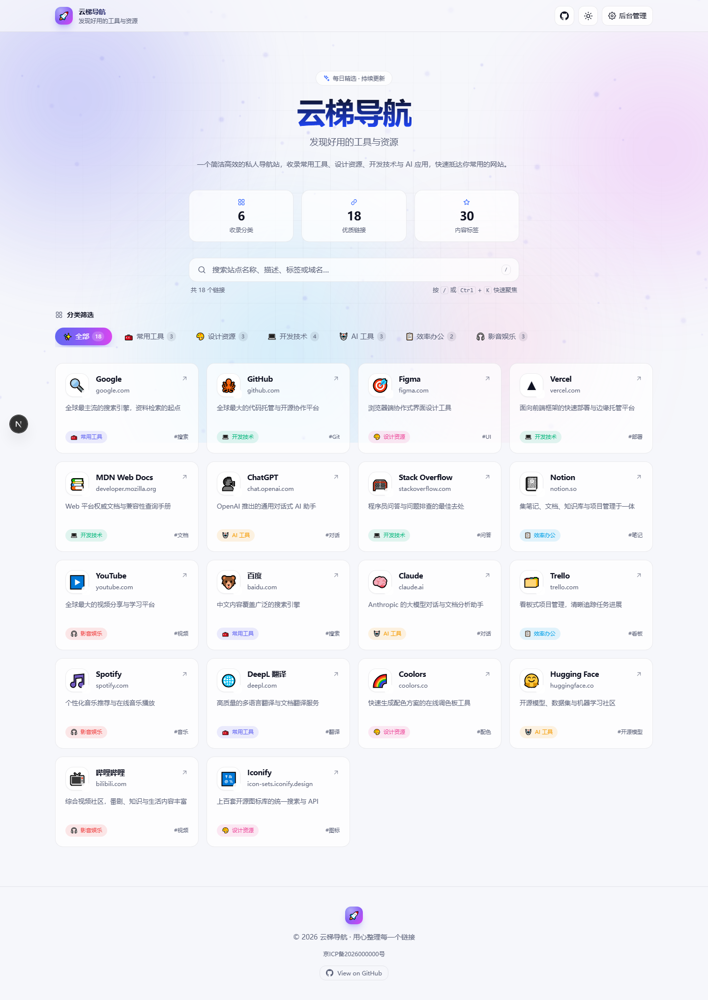

### 前台 · 深色模式

> 深色下背景切换为星点粒子 + 极光光晕

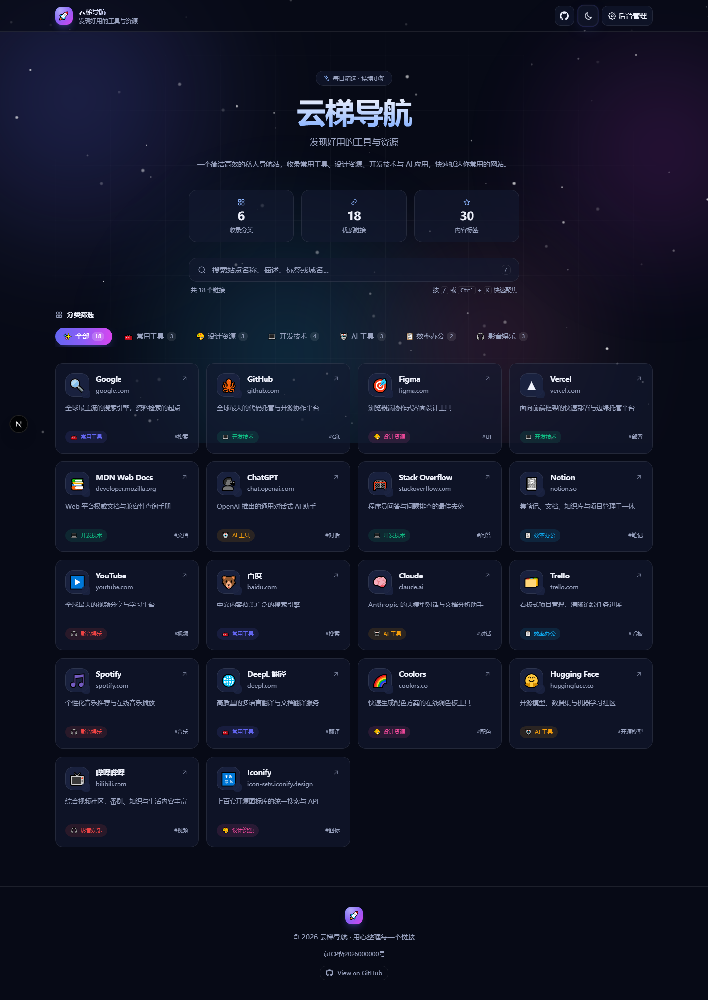

### 卡片悬停效果

> 卡片上浮、边框发光扫过、图标旋转、箭头位移

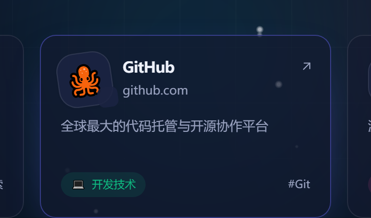

### 实时搜索

> 输入关键词即时过滤，显示匹配数量

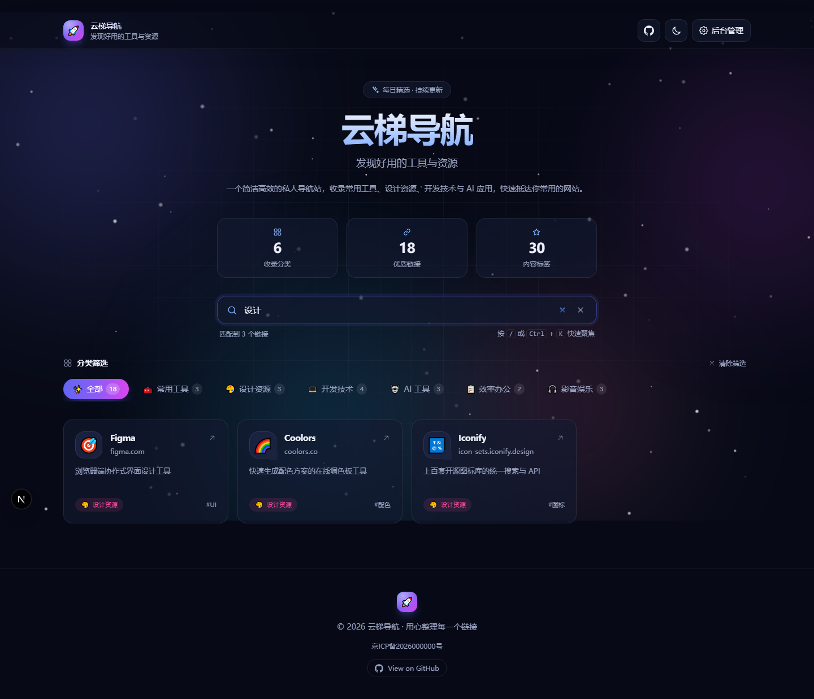

### 分类筛选

> 点击分类胶囊，滑块高亮平滑移动

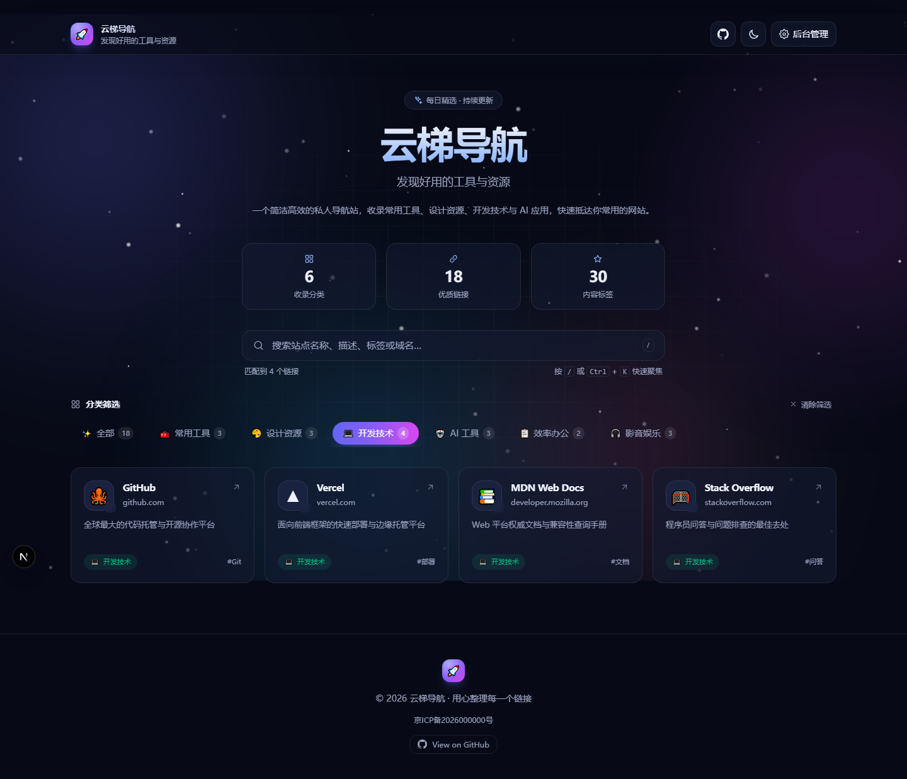

### 移动端

> 390px 视口下单列布局 + 汉堡菜单

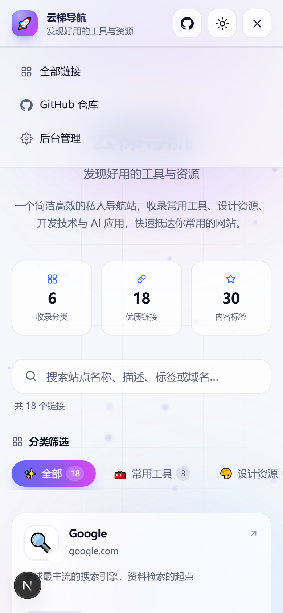

### 后台 · 登录页

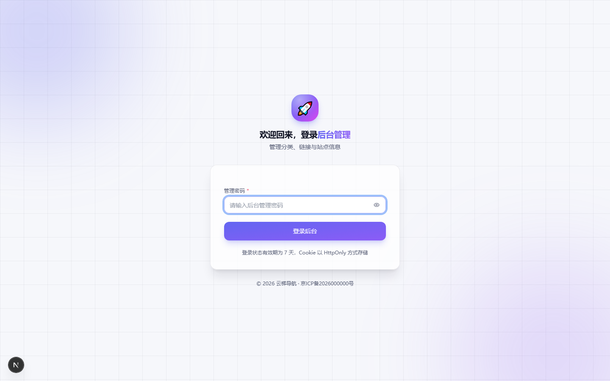

### 后台 · 仪表盘

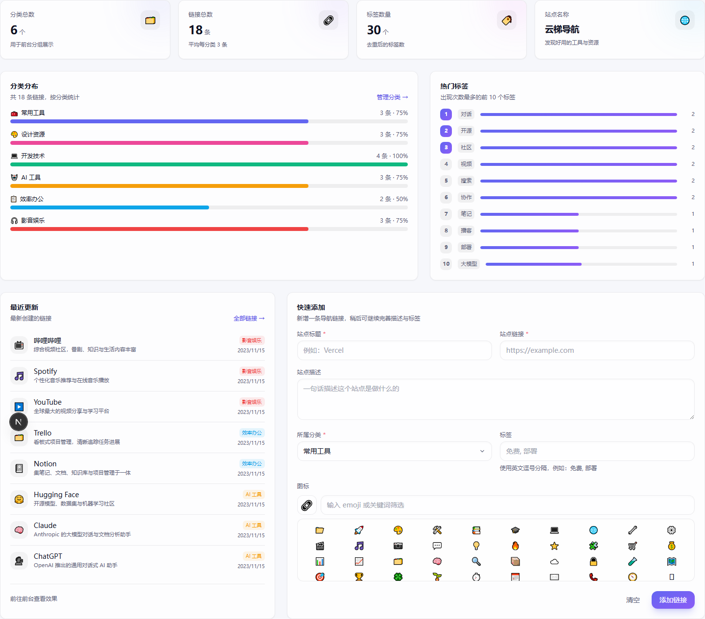

### 后台 · 分类管理

> 支持颜色选择器、Emoji 快选、排序

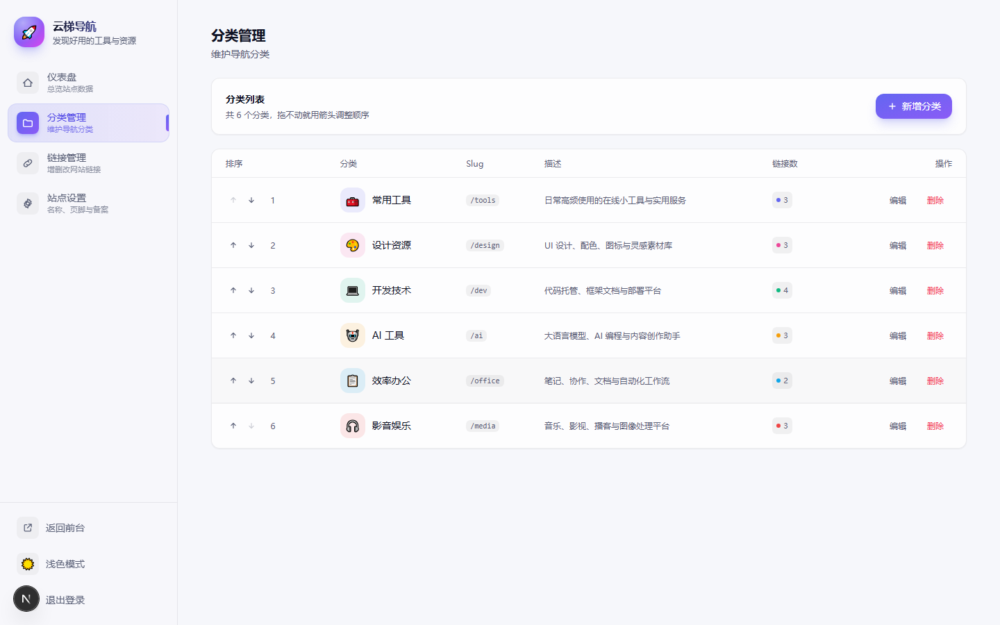

### 后台 · 链接管理

> 按分类分组展示，支持增删改与排序

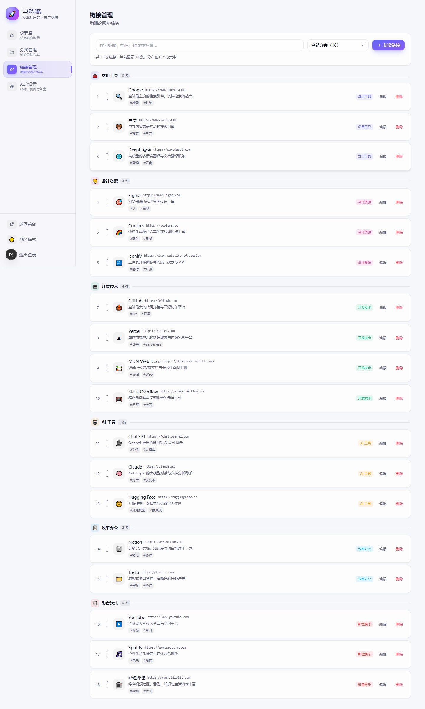

### 后台 · 站点设置

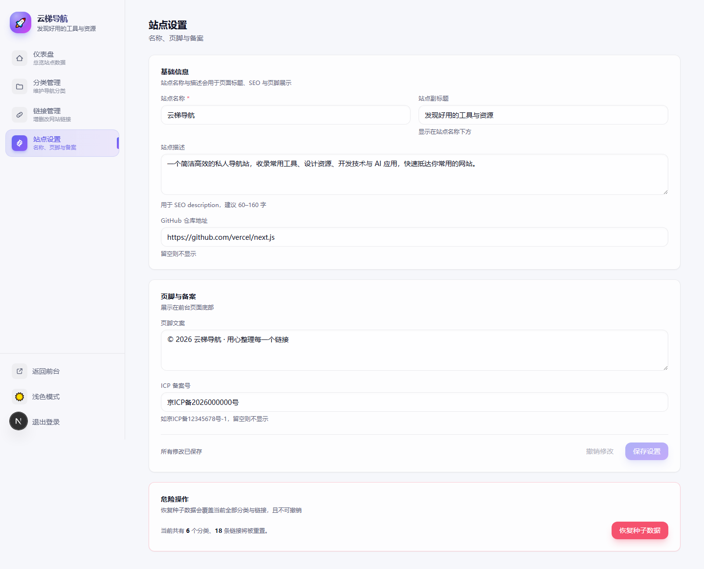

> **在线体验完整功能**：https://nav-cms.vercel.app

---

## 🚀 部署指南

### 方式一 · Vercel 一键部署（推荐）

[](https://vercel.com/new/clone?repository-url=https://github.com/yuanshang000/nav-cms)

点击上方按钮即可自动部署。部署完成后需要做两件事：

**第 1 步 · 配置环境变量**

进入 Vercel 项目 → **Settings** → **Environment Variables**，添加：

| 变量 | 值 | 说明 |
| --- | --- | --- |
| `ADMIN_PASSWORD` | 你自己设置的密码 | **必填**，后台登录密码 |
| `AUTH_SECRET` | `openssl rand -hex 32` 生成 | **必填**，用于签名登录 Cookie |

**第 2 步 · 创建 KV 数据库**

进入项目 → **Storage** → **Create Database** → 选 **KV** → **Connect**，Region 建议选 **Singapore (SIN1)**。

创建完成后 Vercel 会自动注入 `KV_REST_API_URL` 与 `KV_REST_API_TOKEN`，**无需手动配置**。

访问 `https://你的域名/admin`，用 `ADMIN_PASSWORD` 登录即可开始使用。

### 方式二 · 命令行手动部署

```bash
# 1. 克隆项目
git clone https://github.com/yuanshang000/nav-cms.git
cd nav-cms

# 2. 安装依赖
npm install

# 3. 配置环境变量
cp .env.example .env.local
# 编辑 .env.local，至少设置 ADMIN_PASSWORD

# 4. 本地开发
npm run dev
```

部署到 Vercel：

```bash
npm install -g vercel
vercel login

# 创建 KV 库并连接
vercel storage connect upstash/upstash-kv --environment production --name nav-db

# 设置环境变量
echo -n "你的密码" | vercel env add ADMIN_PASSWORD production --sensitive
echo -n "$(openssl rand -hex 32)" | vercel env add AUTH_SECRET production --sensitive

# 部署
vercel --prod
```

---

## ⚙️ 环境变量说明

| 变量 | 必填 | 说明 |
| --- | :---: | --- |
| `ADMIN_PASSWORD` | ✅ | 后台登录密码 |
| `AUTH_SECRET` | ✅ | 签名登录 Cookie 的密钥，**请妥善保存**。更换后用户需重新登录（不影响数据） |
| `KV_REST_API_URL` | ✅ | KV / Upstash REST 地址，创建 KV 后自动注入 |
| `KV_REST_API_TOKEN` | ✅ | KV / Upstash REST Token，创建 KV 后自动注入 |

> ⚠️ **不配置 KV 会怎样**：数据会写入本地 `data/store.json`，Serverless 环境磁盘只读，
> **每次部署或冷启动数据都会重置**。正式使用请务必创建 KV。

---

## 📁 项目结构

```
nav-cms/
├── src/
│   ├── app/
│   │   ├── layout.tsx              # 根布局 + 主题防闪烁脚本
│   │   ├── page.tsx                # 前台首页
│   │   ├── icon.svg                # 站点图标
│   │   ├── globals.css             # Tailwind + CSS 变量主题
│   │   └── admin/                  # 后台（Server Component）
│   │       ├── layout.tsx          #   外壳 + 服务端鉴权
│   │       ├── page.tsx            #   仪表盘
│   │       ├── login/              #   登录页
│   │       ├── categories/         #   分类管理
│   │       ├── links/              #   链接管理
│   │       └── settings/           #   站点设置
│   ├── components/
│   │   ├── nav-app.tsx             # 前台主应用
│   │   ├── background.tsx          # 动态背景（极光 + 粒子）
│   │   ├── theme-toggle.tsx        # 日夜主题切换
│   │   ├── site-logo.tsx           # Logo 组件
│   │   ├── icons.tsx               # 内联 SVG 图标库
│   │   └── admin/ui.tsx            # 后台共用 UI 组件
│   ├── lib/
│   │   ├── types.ts                # 类型定义
│   │   ├── store.ts                # 数据层（KV / 本地文件双实现）
│   │   ├── actions.ts              # Server Actions
│   │   ├── auth.ts                 # 服务端鉴权
│   │   ├── auth-edge.ts            # Edge 版鉴权（Web Crypto）
│   │   ├── auth-actions.ts         # 登录 / 登出
│   │   └── seed-data.ts            # 初始示例数据
│   └── proxy.ts                    # 后台路由拦截（Edge）
├── docs/screenshots/               # README 配图
├── .env.example                    # 环境变量示例
└── vercel.json
```

---

## 🛠 技术栈

| 层 | 选型 |
| --- | --- |
| 框架 | Next.js 16（App Router）+ React 19 + TypeScript |
| 样式 | Tailwind CSS 3（`darkMode: 'class'`）+ CSS 变量主题 |
| 动画 | Framer Motion |
| 存储 | Vercel KV（Upstash Redis REST） |
| 鉴权 | HMAC-SHA256 签名 Cookie + Edge 中间件 |
| 部署 | Vercel |

---

## ❓ 常见问题

**Q：部署后后台添加的内容刷新就没了？**

八成是 KV 没连上。检查环境变量里 `KV_REST_API_URL` 和 `KV_REST_API_TOKEN` 是否都存在，然后**重新部署**使其生效。

**Q：部署时构建失败？**

本项目未固定 Node 版本，若出现兼容问题可在 `package.json` 加 `"engines": { "node": "22.x" }` 后重新部署。

**Q：后台无法登录？**

确认 `ADMIN_PASSWORD` 已配置，且改完后**重新部署**才生效。用 `vercel env ls` 可查看现有变量。

**Q：数据偶尔丢失？**

可能是 KV 区域与函数区域距离过远导致超时。把 KV 建在 **Singapore (SIN1)**，并在 `vercel.json` 中加 `"regions": ["sin1"]` 保持一致。

**Q：想改后台密码？**

修改 Vercel 环境变量 `ADMIN_PASSWORD` 后**重新部署**生效。

---

## 📄 License

MIT License © 2026

欢迎 Fork 和 Star ⭐，拿来改成你自己的导航站。

---

<div align="center">

**[⬆ 返回顶部](#🚀-云梯导航--nav-cms)**

在线演示：https://nav-cms.vercel.app

</div>
